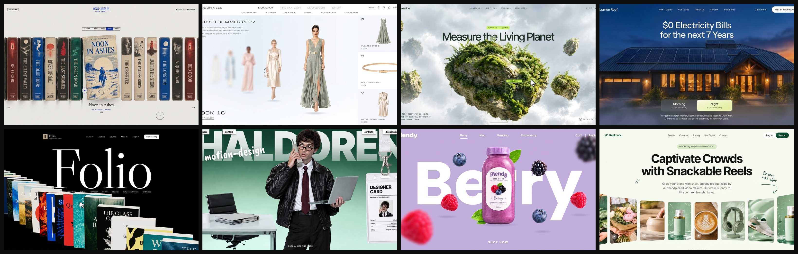

# MotionSites Web Builder: a free Claude skill

**Make Claude build award-level, cinematic landing pages instead of average AI layouts.**

AI-built websites tend to look the same because they start from a vague idea and no real media. This skill starts from a **real, finished design** that people already love: Claude picks the one [MotionSites](https://motionsites.ai/?utm_source=github&utm_medium=claude-skill&utm_campaign=web-builder) design that best fits your brief, makes it yours (your copy, colours and media), builds it, then **looks at a screenshot and fixes what's off**.


<sub>8 of the 16 designs inside the skill. Each one is a full, detailed build prompt Claude can start from.</sub>

## What's inside
- **16 hand-picked designs:** free MotionSites designs people are copying most right now, from a VHS-shelf portfolio and a runway lookbook to a floating-island SaaS hero and a 3D bookshop. Each has a one-line "what it is and how it feels" so Claude picks the right one fast.
- **A media shelf:** 76 free hero background videos from [motionsites.ai/backgrounds](https://motionsites.ai/backgrounds?utm_source=github&utm_medium=claude-skill&utm_campaign=web-builder), each described by mood, plus the videos, transparent cut-outs and images the designs use. Shown on numbered contact sheets so Claude picks by eye.
- **55+ technique recipes** with working code: seamless video loops, liquid glass, word-by-word blur headlines, mouse-scrubbed video, depth carousels, scroll stories, real 3D (Three.js) and more.
- **Taste rules with real numbers:** type scale, tracking, spacing, colour, motion timing and copy.
- **A look-and-fix step:** a screenshot + QA script and a short checklist. One round, not an endless loop.
- **Works where you work:** inside your existing React/Next/Vite project, or as a single `index.html` that opens anywhere.
- **Prompt mode:** ask for a prompt instead of code, tuned for Lovable, Bolt, v0, Cursor, Manus, Google AI Studio or Kimi.
- **Even better with the [MotionSites MCP](https://motionsites.ai/mcp?utm_source=github&utm_medium=claude-skill&utm_campaign=web-builder):** if it's connected, Claude picks from the full library instead of the free sample.

## Install

### Claude.ai and Claude desktop
1. Download **`motionsites-web-builder.zip`** from the [latest release](../../releases/latest).
2. In Claude, open **Customize → Skills → + → Create skill → Upload a skill**, choose the zip, and switch the skill on. (Code execution must be enabled in Settings → Capabilities.)

### Claude Code (plugin)
```
/plugin marketplace add Motionsites-AI/claude-skill
/plugin install motionsites-web-builder@motionsites
```
No GitHub SSH key? Use `/plugin marketplace add https://github.com/Motionsites-AI/claude-skill.git` instead.

### Claude Code (manual)
Copy `plugins/motionsites-web-builder/skills/motionsites-web-builder` into `~/.claude/skills/`.

### Optional: let Claude see its work
The look-and-fix loop works best with Playwright:
```
pip install playwright && python -m playwright install chromium
```

## Try it
Just ask Claude for a site. The skill kicks in automatically:
- *"Build a landing page hero for a luxury sleep-tracking ring."*
- *"Make a portfolio homepage for an architectural photographer in Lisbon. Editorial and quiet."*
- *"Write a Lovable prompt for a waitlist page for my AI travel app."*
- *"Here's my current site: make it look award-winning."*

## Want the full library?
The examples and media in this skill are a **free sample**. **[MotionSites Unlimited](https://motionsites.ai/unlimited?utm_source=github&utm_medium=claude-skill&utm_campaign=web-builder&utm_content=readme)** unlocks:
- **500+ premium website prompts,** ready for Lovable, Bolt, v0, Cursor and Claude
- **Animated hero backgrounds** and **section prompts** (features, pricing, footers…)
- **40+ Lovable templates**
- **The MotionSites MCP,** so Claude can search and pull any premium prompt straight into your build
- Use for personal and client work

👉 **[Go Unlimited](https://motionsites.ai/unlimited?utm_source=github&utm_medium=claude-skill&utm_campaign=web-builder&utm_content=readme)**

## License
See [LICENSE](LICENSE). The skill's instructions and code are MIT. The example prompts and media remain © MotionSites; you may use them in sites you build with this skill.
