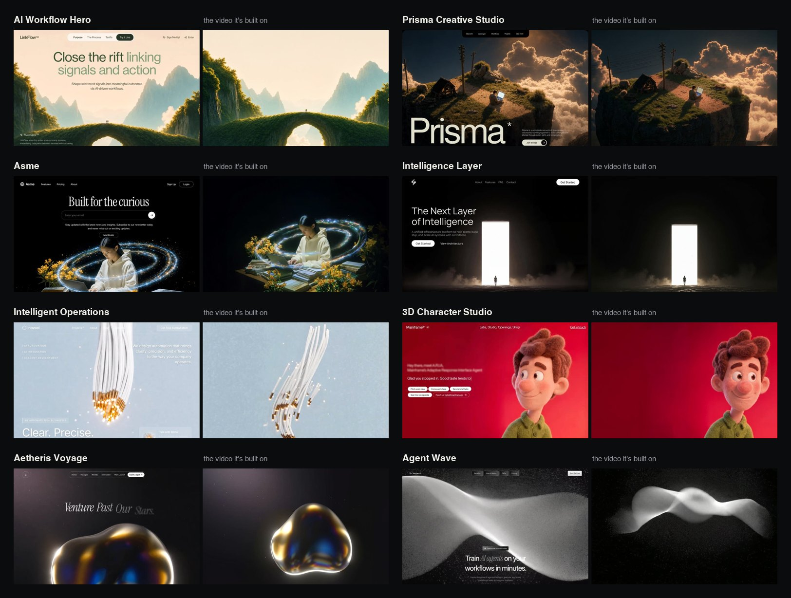

# MotionSites Web Builder: a free Claude skill

**Make Claude build award-level, cinematic landing pages instead of average AI layouts.**

AI-built websites tend to look the same for three reasons: a vague plan, no real media, and nobody looking at the result. This skill fixes all three. Claude studies the most-liked designs from [MotionSites](https://motionsites.ai/?utm_source=github&utm_medium=claude-skill&utm_campaign=web-builder), picks real cinematic media, writes a precise build spec, builds the page, then **screenshots its own work and fixes it** until it clears a gallery-level bar.


<sub>8 of the 40 example designs inside the skill, each shown next to the video it's built on. All 50+ videos are on the skill's media shelf.</sub>

## What's inside
- **40 example prompts:** the most-liked free prompts on MotionSites, the designs people actually love. Claude reads the closest 2–3 for every brief to match their level of detail and taste.
- **A media shelf:** 50+ cinematic hero videos, 30 transparent 3D cut-outs and 29 images, publicly hosted and shown on numbered contact sheets so Claude picks media by eye.
- **55+ technique recipes** with working code, for example:
  - seamless video loops;
  - liquid glass;
  - word-by-word blur headlines;
  - mouse-scrubbed video;
  - spotlight reveals;
  - depth carousels;
  - scroll stories;
  - real 3D models (Three.js).
- **Design taste rules with real numbers:** type scale, tracking, spacing, colour, motion timing and copy.
- **A spec template:** the precise brief Claude writes before coding. That's where quality is decided.
- **A look-and-fix loop:** a screenshot + QA script (broken assets, mobile overflow, fonts, video playback) and a scoring rubric.
- **Prompt mode:** ask for a prompt instead of code, and get one tuned for Lovable, Bolt, v0, Cursor, Manus, Google AI Studio or Kimi.

## Install

### Claude.ai and Claude desktop
1. Download **`motionsites-web-builder.zip`** from the [latest release](../../releases/latest).
2. In Claude, open **Customize → Skills → + → Create skill → Upload a skill**, choose the zip, and switch the skill on. (Code execution must be enabled in Settings → Capabilities.)

### Claude Code (plugin)
```
/plugin marketplace add Motionsites-AI/claude-skill
/plugin install motionsites-web-builder@motionsites
```
No GitHub SSH key? Use `/plugin marketplace add https://github.com/Motionsites-AI/claude-skill.git` instead.

### Claude Code (manual)
Copy `plugins/motionsites-web-builder/skills/motionsites-web-builder` into `~/.claude/skills/`.

### Optional: let Claude see its work
The look-and-fix loop works best with Playwright:
```
pip install playwright && python -m playwright install chromium
```

## Try it
Just ask Claude for a site. The skill kicks in automatically:
- *"Build a landing page hero for a luxury sleep-tracking ring."*
- *"Make a portfolio homepage for an architectural photographer in Lisbon. Editorial and quiet."*
- *"Write a Lovable prompt for a waitlist page for my AI travel app."*
- *"Here's my current site: make it look award-winning."*

## Want the full library?
The examples and media in this skill are a **free sample**. **[MotionSites Unlimited](https://motionsites.ai/unlimited?utm_source=github&utm_medium=claude-skill&utm_campaign=web-builder&utm_content=readme)** unlocks:
- **500+ premium website prompts,** ready for Lovable, Bolt, v0, Cursor and Claude
- **Animated hero backgrounds** and **section prompts** (features, pricing, footers…)
- **40+ Lovable templates**
- **The MotionSites MCP,** so Claude can search and pull any premium prompt straight into your build
- Use for personal and client work

👉 **[Go Unlimited](https://motionsites.ai/unlimited?utm_source=github&utm_medium=claude-skill&utm_campaign=web-builder&utm_content=readme)**

## License
See [LICENSE](LICENSE). The skill's instructions and code are MIT. The example prompts and media remain © MotionSites; you may use them in sites you build with this skill.
